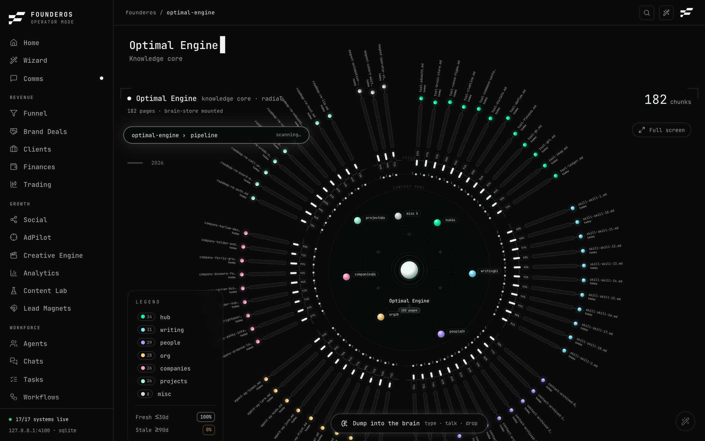
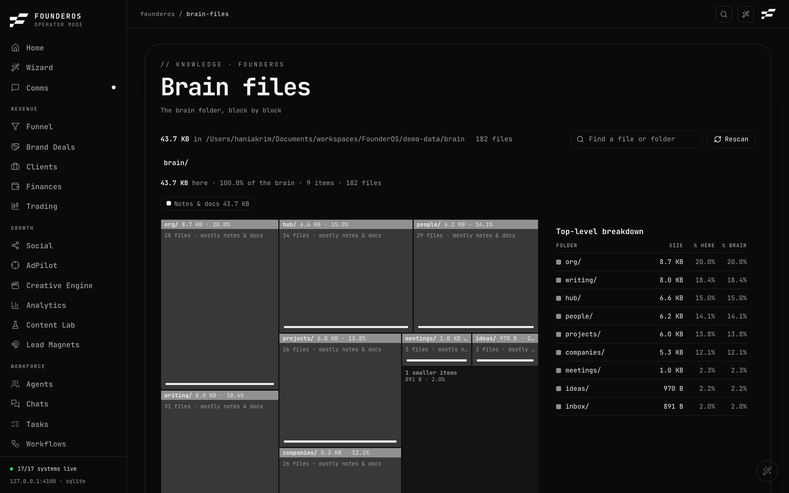
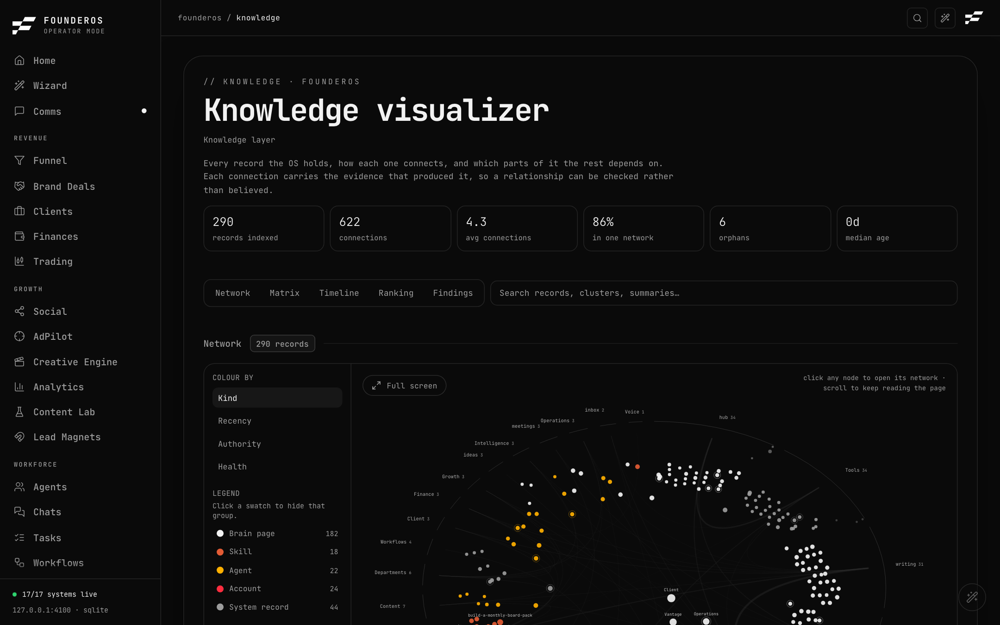
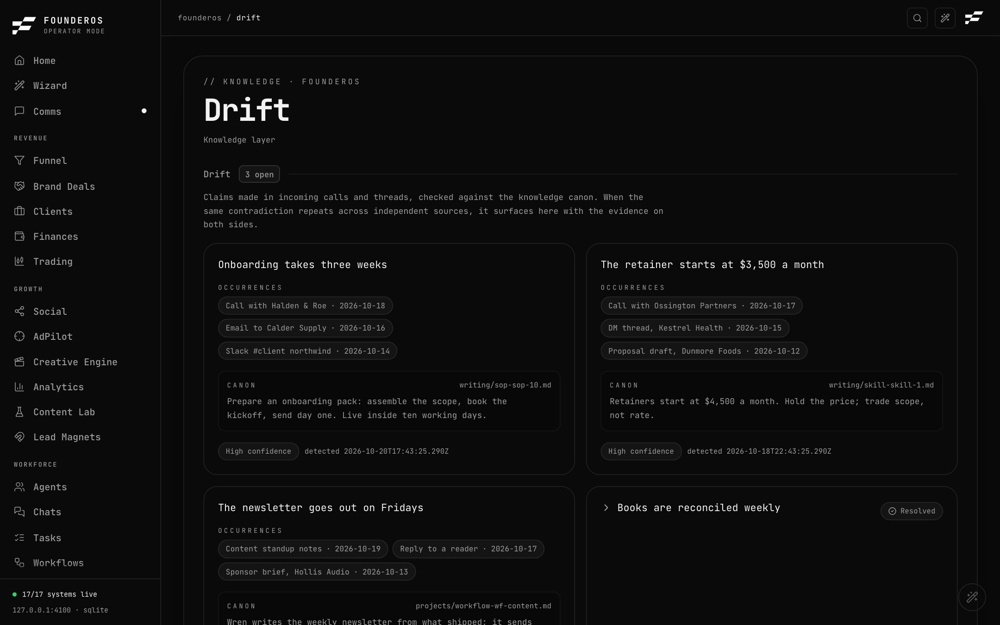

# Knowledge

The Knowledge area is where FounderOS keeps what you and your agents know, and lets you search it, look at it, and check it for contradictions.

| Page | Address | Use it to |
|---|---|---|
| [Optimal Engine (Brain)](#optimal-engine-brain) | `/brain` | Ask your notes a question, add notes, check the health of the knowledge store |
| [Brain files (Database)](#brain-files-database) | `/database` | Browse the brain folder on disk, sized block by block |
| [Knowledge visualizer](#knowledge-visualizer) | `/knowledge` | See how every record connects and which ones the rest depends on |
| [Drift](#drift) | `/drift` | Review claims that contradict your canon |

Two things apply to every page below:

- **Demo mode.** A fresh install opens on a fictional company with its own sample knowledge base. Nothing in it is real. Turn it off in Settings (the switch is called Filming mode). See [Settings](../system/settings.md).
- **Not configured.** When a page needs something you have not set up, it says so with a *Not configured* badge and a *Set up* link, rather than showing made-up data. See [Integrations](../system/integrations.md).

---

## Optimal Engine (Brain)

**What it is for.** Optimal Engine is your searchable knowledge base. It is a folder of markdown notes (the brain store) that FounderOS indexes so you and your agents can ask questions in plain language. Behind it sits the gbrain command-line tool, which handles the indexing and searching.

### What you see

The page is titled **Optimal Engine** and opens on a large living view of your notes. From top to bottom:

- **The radial view.** Your notes arranged by folder around a core. Year buttons filter by when a note was made, and a full-screen button gives you pan and zoom. An ask bar sits at the top left (see below).
- **Capture.** A small card floating at the bottom middle, described below.
- **Knowledge graph.** A graph of agents, departments, people, tasks and the memory constellation, with a count of nodes. It loads separately, so the rest of the page never waits on it. It prefers live client data from Attio when Attio is connected, and otherwise uses your local funnel.
- **Pillar health.** A radar chart of the pillars of the knowledge base.
- **Doctor.** The result of the engine's own health checks: "ok", "warnings" or "unreachable", and when a brain agent last ran.
- **Hybrid search.** A panel for the search the engine runs.
- **Pipeline.** Three stages: the markdown brain store on disk, the engine command-line tool, and the Supabase Postgres database with pgvector that holds the searchable chunks. Page and chunk counts appear only when the engine answers; otherwise the page says they are unavailable. It never shows remembered counts.
- **Query path.** A diagram of how a question is answered: the question is expanded into variants, keyword and vector search run side by side, the results are merged into one ranking, and ranked snippets come back.

### What you can do

#### Ask the brain

Type in the ask bar ("ask a question..." or "Ask the brain a question...") and press Enter. FounderOS runs the search live against your notes and shows the answer, with its sources, in a notice above the view. Typed questions also dim the notes that do not match. When the store is not found, the bar is disabled and reads "brain-store not mounted".

If the database behind the engine is paused or unreachable, search falls back to a plain text search over the markdown files. It has fewer smarts but keeps working. The brain store on disk always works.

#### Capture a note

The capture card opens when you point at it, and stays open while you use it. If you collapse it mid-sentence, your draft is kept.

- Type or paste text into the box ("Dump into the brain, or drop documents").
- Click the microphone to dictate (voice needs a browser that supports it, such as Chrome or Safari).
- Drag documents onto the card, or click **Upload** to choose files. Each document becomes one note.
- Optionally give it a title (otherwise it is taken from the first words) and tag a venture.
- Click **Save**.

FounderOS writes a real markdown file into your brain store and then embeds it so it can be found by search. The status line tells you which happened: "Embedded" means it is searchable now; "Saved" means the file is written but the engine was unreachable, so indexing will wait.

#### Read the health of the store

Use the Doctor and Pipeline sections. A warning shows what the engine checked and a *Set up* link. Settings holds the paths (see below).

### What it needs

Search and indexing need the gbrain command-line tool. To wire it:

1. Install it with `bun install -g github:garrytan/gbrain` (not the npm package of the same name).
2. Run `gbrain init --pglite --no-embedding`.
3. Run `gbrain import ~/path/to/your/notes --no-embed`.
4. Set `GBRAIN_BIN` (absolute path to the binary) and `GBRAIN_STORE` (your notes folder) in `.env.local`.

The embedded database allows one writer at a time. Run the command-line tool, as FounderOS does, or a long-running `gbrain serve`, not both at once. Setting `BRAIN_PROVIDER=stub` turns the engine off. The full list of variables is in the configuration reference, and [Integrations](../system/integrations.md) shows the connector's status.

When no notes folder is found, the page shows zero pages and "brain-store not found". Nothing is invented.

### Demo mode

The demo company ships its own brain: a store of 180 sample pages and a stub engine that answers from them. Asking and browsing work. Capturing a note writes into the demo data, never into your real store.

### How to: search the brain

1. Open **Optimal Engine** from the sidebar.
2. Wait for the view to load. If the bar says "brain-store not mounted", fix the setup first (see "What it needs").
3. Click the ask bar and type a question, for example "What did we agree with our biggest client about pricing?".
4. Press Enter.
5. Read the answer in the notice above the view, and check the source names listed with it.
6. Look at which notes brightened in the view to see where the answer came from.

### How to: add a note to the brain

1. Open **Optimal Engine** and point at the capture card at the bottom middle.
2. Type or paste the note, dictate it, or click **Upload** and choose documents.
3. Add a title or venture tag if you want.
4. Click **Save**.
5. Check the status line. "Embedded" means it can be found right away.

---

## Brain files (Database)

**What it is for.** A map of the brain folder on disk, so you can see what is taking up space and read individual files. The page title is "Brain files". It reads the folder straight from disk each time you visit (cached for about a minute).

### What you see

- A block map. Every file and folder is a block sized by the space it uses.
- A path bar across the top (breadcrumbs) with an **Up** button (Esc also goes up one level).
- Filter chips by file type: Notes and docs, Video, Images, Audio, Code and config, Data and archives, Git and system, Other. Click a chip to show only that type, and click again to clear.
- A list beside the map with each item's size, its share of the current folder and its share of the whole brain.
- A search box ("Find a file or folder").
- A note when the folder is huge: the map stops at 60,000 entries.

### What you can do

- Click a folder to zoom in. Click a file to open a preview on the side. Text files show their contents (the first 24 KB). Binary files say they have no preview and give you the path.
- Files marked private are never shown. The page says the contents stay on disk.
- **Rescan** to read the folder again.

This page is read-only. You cannot edit, move or delete anything here.

### What it needs

A brain folder. FounderOS looks for `BRAIN_DIR` in `.env.local`, then `~/Desktop/brain`, then `~/Sync/brain`. If none exist, the page shows a *Not configured* badge, "No brain folder found on this machine", where it looked, and a *Set up* link to Settings.

### Demo mode

The map shows the demo company's sample brain folder.

### How to: find what is taking up space

1. Open **Brain files**.
2. Look for the biggest blocks. Click one to zoom in.
3. Use a file-type chip to narrow to one kind, for example Video.
4. Click a file for a preview, or read its full path in the panel.
5. Press Esc or click **Up** to go back.

---

## Knowledge visualizer

**What it is for.** One graph over everything FounderOS knows: notes, skills, agents, people, clients, workflows, tools and departments. Optimal Engine is where you retrieve; this page is where you analyse. Every connection shows the evidence behind it, so you can check a relationship instead of taking it on trust.

### What you see

- A row of summary tiles at the top.
- A search box ("Search records, clusters, summaries...").
- Five views, switched with buttons:
  - **Network**: how everything connects.
  - **Matrix**: which clusters talk to each other.
  - **Timeline**: what has gone cold.
  - **Ranking**: the numbers, sortable.
  - **Findings**: the structural audit.
- **Colour by**: Kind (what sort of record), Recency (how long since it was edited), Authority (how much the graph relies on it) or Health (what is structurally wrong with it), with a legend. Click a swatch in the legend to hide that group.
- **Connection kinds**: link (an author wrote a `[[link]]`), owns (a relationship recorded in the database), mention (a record's name appears in another's text, with the sentence shown) and similar (shared distinctive vocabulary). Similar is inferred rather than observed, so it is off by default.
- Full-screen buttons for the network and the matrix.

### What you can do

- Search, colour and filter.
- Click a record to open its detail panel and read the evidence for each of its connections.
- Turn connection kinds on or off.
- Read Findings for the structural audit.

The page is read-only. It does not change any record.

### What it needs

No connector. It reads your brain store, your skills folder and your database. With nothing to index, it says "Nothing to index". The analysis is cached against the state of the files on disk, so a very large knowledge base can make the first load slower.

### Demo mode

It indexes the demo company's sample pages, skills and records.

### How to: find your most important notes

1. Open **Knowledge visualizer**.
2. Click **Ranking** to see records sorted by how much the rest depends on them.
3. Click **Findings** to see structural problems.
4. Switch **Colour by** to **Recency** and look at **Timeline** to spot notes that have gone cold.
5. Click any record to read the evidence for its connections.

---

## Drift

**What it is for.** Drift catches contradictions. Claims made in incoming calls and threads are checked against your knowledge canon. When the same contradiction shows up across independent sources, it appears here with the evidence on both sides.

### What you see

- A heading with the count of open items.
- Cards for each contradiction, each showing:
  - **Occurrences**: where the claim was made, with a short quote from each source.
  - **Canon**: the passage in your canon it disagrees with, and the file it lives in.
  - A confidence chip and the date it was detected.

### What you can do

On a card that has a proposed fix, two buttons:

- **Update canon** shows a proposed change as removed and added lines, with a **Copy** button for the new passage. Drift does not write anything. You paste the passage into the named file yourself.
- **Draft correction** shows a message to the person responsible, with a **Copy** button. Drift does not send it. You can paste it into [Comms](command.md) or any other channel.

### What it needs

A detection pipeline that extracts claims from calls and threads and records them. Until that is running there are no insights, and the page shows a "not configured" state that explains what Drift does and that the extraction pipeline is not set up. It never invents contradictions.

### Demo mode

The demo company includes sample drift insights so you can see how cards look and work.

### How to: resolve a drift item

1. Open **Drift**.
2. Read the occurrences and the canon passage to confirm the contradiction is real.
3. If your canon is wrong, click **Update canon**, click **Copy** on the new passage, and paste it into the canon file named on the card.
4. If the claim came from a person who is mistaken, click **Draft correction**, click **Copy**, and send it through your usual channel.
