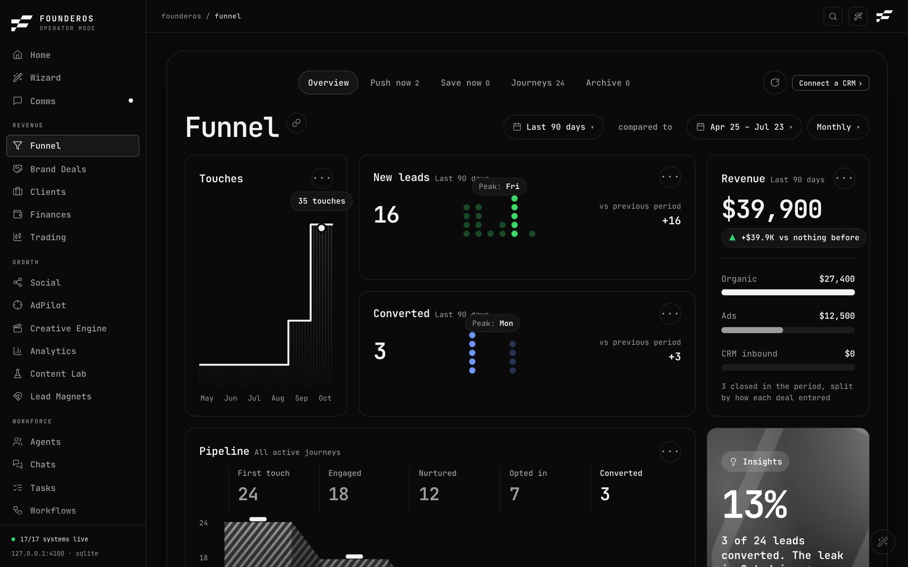
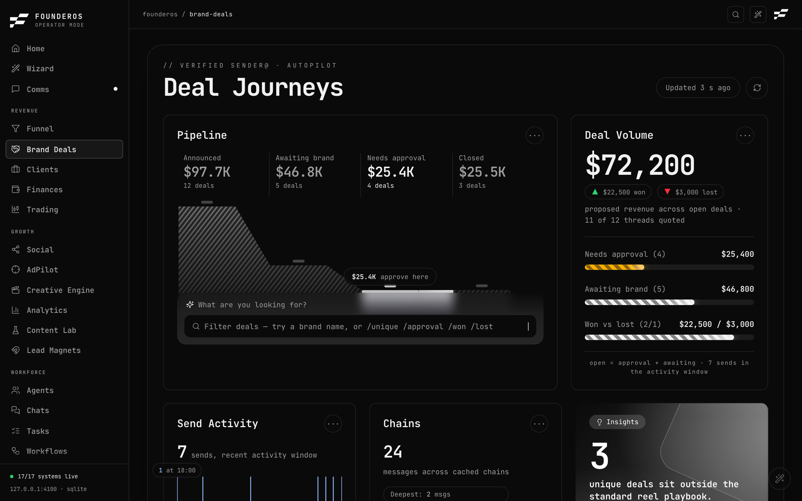
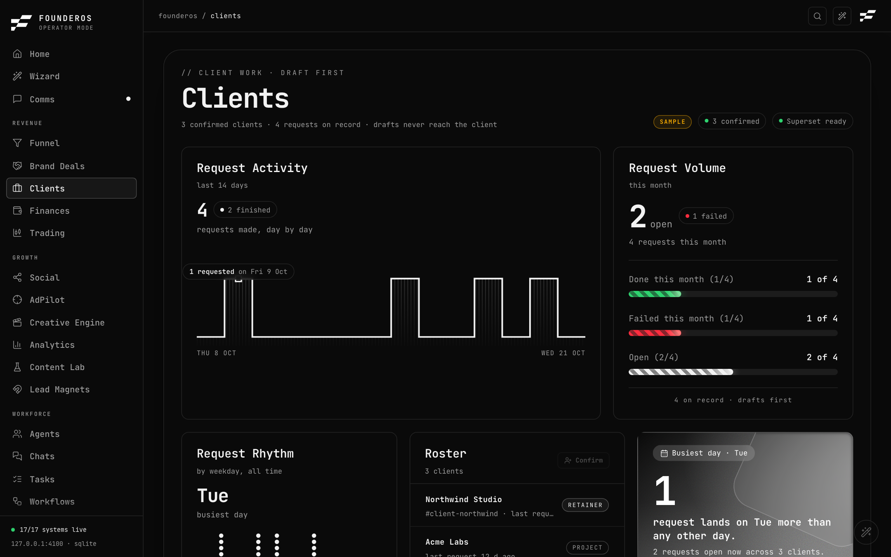
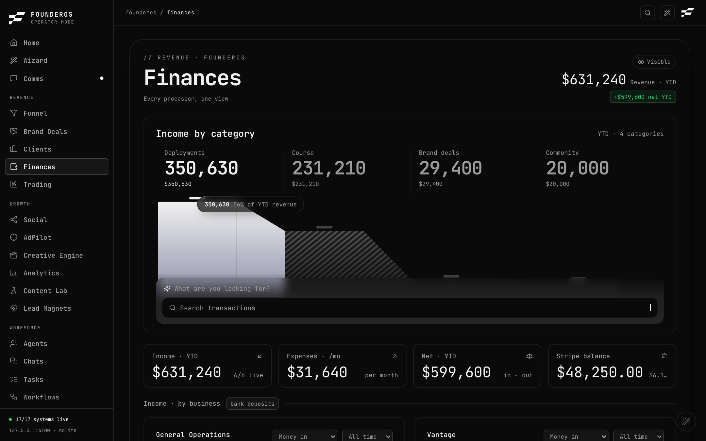
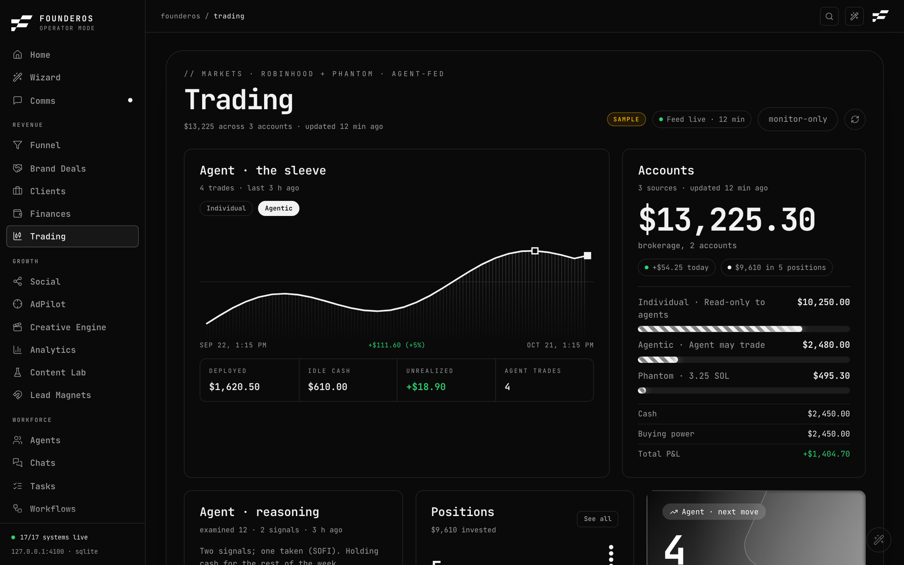

# Revenue

The Revenue area is about money coming in: the leads you are working, the brand deals in your inbox, the clients you serve, the cash across your processors, and your trading accounts.

| Page | Address | Use it to |
|---|---|---|
| [Funnel](#funnel) | `/funnel` | See every lead from first touch to paying customer, and who to chase today |
| [Brand Deals](#brand-deals) | `/brand-deals` | Review, approve and track sponsorship replies |
| [Clients](#clients) | `/clients` | Confirm who your clients are and keep a queue of work requests for each |
| [Finances](#finances) | `/finances` | See income from every processor, expenses from uploaded statements, and net |
| [Trading](#trading) | `/trading` | Watch your accounts and set limits for the trading agent |

Three things apply to every page below:

- **Demo mode.** A fresh install opens on a fictional company. Everything you see is sample data and nothing real is read or sent. Turn it off in Settings (the switch is called Filming mode). See [Settings](../system/settings.md).
- **Not configured.** When a page needs a connector you have not set up, it says so with a *Not configured* badge and a *Set up* link instead of showing made-up numbers. Connector keys are covered in [Integrations](../system/integrations.md).
- **Appearance.** Settings offers more than one look. The content and controls are the same in each; only the layout and styling change.

---

## Funnel

**What it is for.** The Funnel shows every lead as a *journey* through five stages, so you can see where leads come from, who is hot, and who is fading. Its job is to answer "who should I contact today?"

The five stages are **First touch**, **Engaged**, **Nurtured**, **Opted in** and **Converted**.

### Where the data comes from

The Funnel reads leads from whichever of these are connected, and merges them:

| Source | Needs | What it adds |
|---|---|---|
| Attio (CRM) | An Attio connection | Deals as journeys |
| GoHighLevel | `GHL_API_KEY` and `GHL_LOCATION_ID` | Contacts as journeys |
| Trakyo | `TRAKYO_API_KEY` | The first touch for each lead (which post or ad brought them in), and tracked links |
| Meta Ads | A Meta ad account | A source chip (paid media) |

If none of the CRMs has leads, the page falls back to the journeys stored in your own database. On a blank install that means an honest, empty page. A line near the top tells you which source you are looking at (for example "Attio 42 + GHL 18", "local"). Source chips along the top show each connector as connected or not, with a link to connect it.

### What you see

**Views.** A row of tabs: **Overview**, **Push now**, **Save now**, **Journeys** and **Archive**. Push now, Save now, Journeys and Archive show a count.

**Controls.** Choose the period (Last 30 days, Last 90 days, Last 12 months, All time), what to compare against (previous period, the same period last year, or no comparison), and monthly or weekly grain. A **Refresh** button re-reads the CRM and local journeys. A **copy link** button copies a link to exactly the view you are looking at, including filters.

**Overview** has these cards:

- **Pipeline**: active journeys by stage. Click a stage to focus it.
- **Revenue**: money from converted leads in the period, with the change versus the comparison period. It is split by lane: **Organic**, **Ads** and **CRM inbound**. Click a lane to see the deals that closed there.
- **Touches**: contact points over time.
- **New leads** and **Converted**: counts for the period with a peak marker.
- **Tracked links** (needs Trakyo): see below.
- **Channels** (needs Trakyo): which channel brought leads, how many booked or converted, and the revenue. Without Trakyo this card says "Channel attribution needs Trakyo" with a *Set up* link.

**A prompt bar** at the bottom of the Overview says "What would you like to explore next?". It is not an AI. It understands slash commands: `/first-touch`, `/engaged`, `/nurtured`, `/opted-in`, `/converted` (jump to Journeys on that stage), `/organic`, `/ads`, `/crm` (filter by lane), `/push`, `/save`, `/archive` and `/overview`. Type `/` to see the list.

**Push now** lists hot leads: likelihood 70 or higher, converted ones excluded, still in motion, freshest first. **Save now** lists leads fading toward the archive (quiet for more than 21 days), the most likely to convert first. Each is capped at the top four on the Overview rail.

**Journeys** is a table of all active leads with Client, Stage, Quiet (days since the last touch), Relationship, Likelihood, Entry, Value and Contact. Chips filter by stage.

**Archive** holds leads that have been quiet for more than 90 days. They leave the active views automatically.

**Dossier.** Click any lead row to open a side panel with the stage reached, status, relationship, likelihood, entry, value, first seen, every touch (stage, source, date) and the contact details. The email links open your mail app, and a phone number opens WhatsApp. If the lead is not converted, the panel says "Next touch is yours".

### What you can do

- Change period, comparison, grain and filters.
- Open a dossier and contact a lead by email or WhatsApp.
- Create a tracked link (Trakyo and writes enabled only).
- Refresh from the sources.

You cannot edit a lead's stage here. Stages follow your CRM.

### How to

**Decide who to contact today**

1. Open `/funnel`.
2. Click **Push now**. These are hot leads. Open the first row to read the dossier.
3. Use the email or phone link in the dossier to reach out.
4. Click **Save now**. These are leads slipping away. Pick the highest likelihood first and send a nudge.

**Create a tracked link**

1. On the Overview, find **Tracked links**. If it says *Not configured*, set `TRAKYO_API_KEY` first (see [Integrations](../system/integrations.md)).
2. Click **New link**. If the button is greyed out, outbound writes are off. The tooltip says "Outbound writes are off on this instance. Set GLADOS_WRITES=1 to create links."
3. Enter the **Destination URL**, a **Source** (for example Instagram) and a **Campaign**, or a **Content id** instead. Optionally pick a **Domain**.
4. Click **Create link**. A confirmation asks "Create link in Trakyo?". Confirm.
5. The new short link appears in the table with its destination and click count.

**Share a view**

1. Set the period, filters and tab the way you want them.
2. Click the copy-link button. "Link copied" appears.

### Demo mode and preview

In demo mode the Funnel shows invented journeys from the demo company, including first touches, so the Channels card is filled. On a real install with no leads, add `?sample=1` to the address (`/funnel?sample=1`) to preview the page on a clearly badged sample set. The default stays honest and empty.

---

## Brand Deals

**What it is for.** The page is called *Deal Journeys*. It follows sponsorship email chains from the first brand message to a won or lost outcome. A background helper called bdpilot reads the emails, drafts replies and tags the unusual ones. You stay in control: nothing is sent without a human approval.

### What you need

- The bdpilot helper running on the same computer, writing its state file (`BDPILOT_STATE`, default `~/.config/bdpilot/state.json`).
- Optionally, the sender tool `gsend` (`GSEND_BIN`) to approve and edit drafts from this page.
- Optionally, `BDPILOT_BOT_URL`, the link to the Telegram approval bot. When it is set, an "approve here or in Telegram" button appears. Otherwise the link is hidden.

If the helper has not reported, the page shows *Not configured*, "bdpilot is not reporting" and a *Set up* link, and no zeros.

### What you see

- **Header.** A freshness pill (the page refreshes by itself every 30 seconds and tells you if the last refresh failed), the Telegram link when set, and a refresh button.
- **Pipeline.** The funnel of deals by stage, with a filter box. Quick filters: **All**, **Needs approval**, **Awaiting** (sent, waiting for the brand), **Unique** (deals the helper flagged as unusual), **Won** and **Lost**. Type a brand name to filter, or use `/unique`, `/approval`, `/won` or `/lost`.
- **Deal Volume.** Dollar value of the open pipeline, split into needs approval, awaiting the brand, and won versus lost.
- **Send Activity.** Recent sends over time.
- **Chains.** How many messages sit across the cached email chains.
- **Deal list.** Brand, email, subject, stage, last event, and the quote. A quote marked "manual" was set by you; otherwise it was read from the thread.

### What you can do

Click a deal to open its panel. What you see depends on its stage.

- **For a deal that needs approval** (a draft is waiting): **Send as the verified sender** (asks for a second click on **Confirm send**), **Skip**, and **Edit draft**.
  - **Edit draft** loads the text. Change it and click **Save draft**. The recipient, subject and thread cannot be changed. This is by design, so an edit can never redirect an email.
  - Sending uses the same safe path as the Telegram tap. If the draft was already sent in Telegram, the second attempt simply fails.
- **Outcome** (any deal): **Mark won**, **Mark lost** or **Reopen**. This is only your tracking. It never emails anyone.
- **Quote**: enter an amount in USD and save. This overrides the amount read from the thread.
- The panel also shows the **Summary** and the full **Email chain** when it was cached.

### How to

**Approve a drafted reply**

1. Open `/brand-deals`.
2. Click **Needs approval** to filter.
3. Click a deal and read the summary and the email chain.
4. If the draft needs changes, click **Edit draft**, edit, and click **Save draft**.
5. Click **Send as the verified sender**, then **Confirm send**.

**Record a result**

1. Open the deal.
2. Under **Outcome**, click **Mark won** or **Mark lost**.
3. Under **Quote**, enter the amount and save if you want the pipeline value to be right.

### Demo mode

In demo mode the board is filled from the demo company's deals. Sending, editing and skipping act on demo data only and nothing is emailed.

---

## Clients

**What it is for.** A short list of the people you serve, and a queue of work requests per client. It is deliberately simple: a payer is not a client until you confirm them.

### What you need

- Attio, to pick clients from your deals (optional). Without it you add clients by hand.
- Superset, to start a request as a draft workspace (optional). Set `SUPERSET_API_KEY` (and optionally `SUPERSET_PROJECT_ID`). Drafts save without it.
- `GLADOS_WRITES=1` to allow launching a request. Without it the launch button explains why it is disabled.

### What you see

- **Request activity**: requests made in the last 14 days.
- **Request volume**: how many requests are open, plus meters for done this month, failed this month and open.
- **Roster**: confirmed clients, with a *retainer* mark where it applies. An "Attio not configured" tag appears if Attio is off.
- **Work requests**: a table with Client, Brief, Status, Age and a row menu. Status is Draft, Queued, Running, Done or Failed.
- **Request rhythm**: requests by weekday, with the busiest day.

### What you can do

- **Confirm a client** from your Attio deals, or **Add by hand** with a name and optional company.
- Click a client in the roster to edit it: set its retainer mark, **Slack channel** (name or id) and **Superset project**, then **Save**. Or **Unconfirm** it.
- **New request**: write a brief for a client and **Save draft request**. Saving never sends anything to the client.
- **Start draft in Superset** on a request: opens a draft workspace there. It is blocked, with a reason, if Superset is not configured, if writes are off, or if the request is already running or done.
- Mark a request **Done** or **Failed**, **Open brief**, or retry a failed one (**Retry in Superset**).

### How to

**Add a client and log a request**

1. Open `/clients` and click **Confirm a client** in the Roster card. If Attio is not connected the button reads **Add client**.
2. Under *Attio deals*, click **Confirm** next to a deal. Or, under *Add by hand*, type a name and click **Add client**.
3. Click **New request**, choose the client and write the brief.
4. Click **Save draft request**. The request appears in the table with the status Draft.

**Give a client a Slack lane**

1. Click the client in the roster.
2. Enter the Slack channel in **Slack channel** (for example `client-name`, or a channel id like `C0123ABCD`). Using the id gives you an "Open Slack channel" link.
3. Click **Save**. That client now has a lane in [Comms, Clients view](command.md#clients-view).

### Demo mode

In demo mode the page shows three invented clients and their requests, marked as sample data. The page is read only (buttons say "Filming mode: read only") and nothing is launched. On a real install with no clients, add `?sample=1` to preview the same sample set.

---

## Finances

**What it is for.** Every place money lands, in one view. Income comes from your payment processors. Expenses come from statements you upload. The page shows net income and where the money went.

### What you need

Add keys for the processors you use. Each is optional.

| Processor | Key | Status today |
|---|---|---|
| Stripe | `STRIPE_SECRET_KEY` | Fully live: month-to-date income, balance, recent charges |
| FanBasis (two accounts) | `FANBASIS_KEY_1`, `FANBASIS_KEY_2` | Month-to-date income |
| Wise (two accounts) | `WISE_1_TOKEN`, `WISE_2_TOKEN` | Outgoing transfers |
| PayPal | `PAYPAL_CLIENT_ID`, `PAYPAL_CLIENT_SECRET` | Key is recorded, income pull is not live |
| Square, Whop | `SQUARE_ACCESS_TOKEN`, `WHOP_API_KEY` | Same: not live yet |

A processor with a key but no live pull shows "key set", never a made-up number. A processor with no key shows a *Connect* link.

### What you see

- **Header.** A big income figure for the period with a net badge, and a **Visible / Hidden** button that blurs every amount (handy on screen shares).
- **Income by category.** A chart of income per processor account, with a **Search transactions** box. Typing filters everything below. With no processor connected it says "No processor income configured yet." with a *Set up* link.
- **Summary tiles.** *Income*, *Expenses · /mo*, *Net* and *Stripe balance*.
- **Spending.** Your uploaded card spend by month and category, top categories (click one to list its transactions) and top merchants. With no statement it says "Upload a statement to see spending."
- **Income by business.** Bank deposits per business, from uploaded bank statements.
- **Income by processor.** A row per processor with its income, "key set" or *Connect*, and a "N/total live" count.
- **Outgoing, Wise.** Recent outgoing transfers. Hidden entirely until a Wise key exists.
- **Recent income.** Latest Stripe charges.

### What you can do

- Search transactions.
- Hide or show amounts.
- Upload statements (below).
- Click through to connect a processor.

### How to

**Upload a statement**

1. Scroll to **Upload statements** (the *Upload a statement* button jumps there).
2. Click **Choose CSV or PDF**.
3. Pick a credit-card **CSV** to see categorized spending. It needs Date, Description and Amount (or Debit and Credit) columns.
4. Or pick a bank statement **PDF** to see per-business income. PDF reading needs the free `pdftotext` tool (installed with `brew install poppler` on a Mac).
5. Wait for the message. A CSV says how many new rows of how many parsed were added. A PDF says the business, month and total money in. The page refreshes.

Re-uploading the same CSV does not duplicate rows. Files are stored on your computer only and are never committed to the repository.

**Connect Stripe**

1. Click **Connect Stripe** next to *Stripe balance* (or open [Integrations](../system/integrations.md)).
2. Add `STRIPE_SECRET_KEY`.
3. Reload `/finances`. The Stripe row turns live once Stripe answers. A key that is present but rejected stays "pending", never "live".

### Demo mode

In demo mode the page shows scripted books: year-to-date income, demo Stripe balance and charges, Wise transfers, per-business income and categorized spending. Uploads still work, but they land in the demo data. Home's income strip shows the same demo books.

On a real install with no statement, add `?sample=1` to preview the Spending card on a badged sample.

---

## Trading

**What it is for.** A read-only window on your accounts, plus the limits for the trading agent. FounderOS never places an order itself. A separate Markets agent does the trading and pushes its results here. You decide how much freedom it has.

### What you need

- `TRADING_PUSH_TOKEN`: any long random string you choose. The Markets agent sends it with each push.
- Optional: `PHANTOM_WALLET_ADDRESS`, a public Solana address (not a key) to show a wallet balance. `SOLANA_RPC_URL` overrides the default free public RPC.

Until the first push, the page shows *Not configured* and "Connect the Markets agent feed. Its first push fills this page." together with the push address to copy. Only the address is shown. The token stays with the agent.

### What you see

- **Header.** A status pill: "Feed live" with how fresh the newest capture is, or a warning if the agent has stopped pushing. A **Refresh** button reloads from the store (the wallet read is cached for 60 seconds).
- **Agent sleeve.** The account the agent trades, with a value chart and a selector for the account shown. Stat cards: *Deployed*, *Idle cash*, *Unrealized* and *Agent trades*.
- **Accounts.** Each source with its value and its share of the total. Phantom shows "not configured" without an address.
- **Agent reasoning.** What the agent examined, how many signals it found, and its notes, every run, whether or not it traded.
- **Positions.** Open positions with value and size buckets. "No open positions." if empty.
- **Agent, next move.** Number of trades filled and the latest note.
- **Open orders.** Live orders at the broker, if any.
- **Trade log.** All trades, filtered by **All**, **Agent**, **You** or **Rejected**. Click a trade for details and its rationale.
- **Agent limits.** Seven numbers and an Autopilot switch (below).

### What you can do

**Set the agent's limits.** Each limit has a range, and values outside it are clamped and reported.

| Limit | What it controls |
|---|---|
| Autonomy budget | Most capital deployed at once without a human |
| Max per trade | Largest single order |
| Max position | % of the sleeve in one name |
| Risk per trade | % of the sleeve at risk on one trade |
| Max positions | Names held at once |
| Trades per day | Orders per day |
| Kill-switch floor | Buys stop if the sleeve falls through this value |

Nothing is shown as saved until you save it. If no limits are stored, the page says so rather than showing defaults.

### How to

**Turn on autopilot**

1. Scroll to **Agent limits**. Fill in all seven numbers and click the save button.
2. Switch **Autopilot** on. A dialog asks "Turn on autopilot?" and explains that the Markets agent will place real orders inside these limits and FounderOS does not place orders itself.
3. Click **Turn on** to confirm. Click **Cancel** to leave it off.

Switching Autopilot off needs no confirmation. Only you, signed in, can change limits. The agent's own token is refused.

**Connect the Markets agent**

1. Set `TRADING_PUSH_TOKEN` in [Settings](../system/settings.md) or `.env.local`.
2. On `/trading`, click **Copy** next to the push address.
3. Give the address and the token to the Markets agent. Its first push fills the page.

### Demo mode

In demo mode the page shows a sample feed, marked with a **Sample** badge, and the limits are read only. No real account is read.
