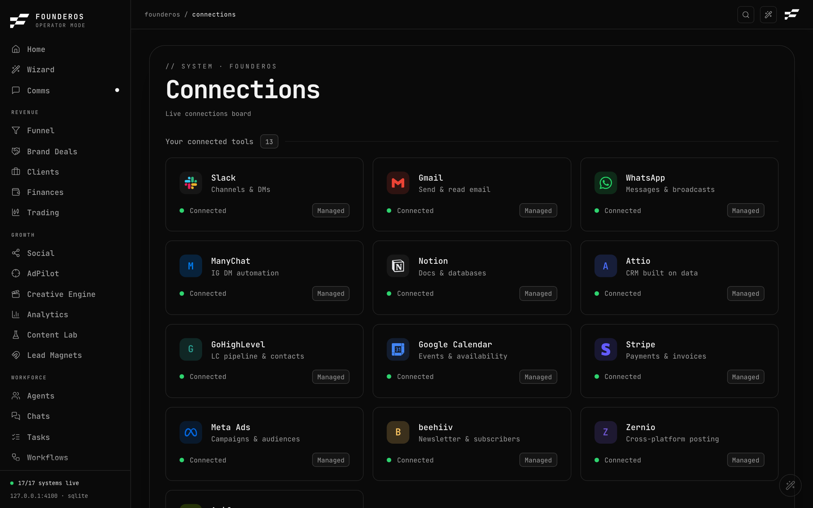

# Integrations (Connections)

The Connections page, at `/integrations`, lists every outside tool FounderOS can reach and its live state. It is in the System group of the sidebar, labelled **Connections**.

## How the page works

- **Your connected tools** lists tools that are answering right now.
- **Popular** lists common tools you have not connected yet.
- **Browse by category** lists everything, grouped (Communication, Productivity, CRM and Sales, Developer, Scheduling, Finance, Marketing, Storage, AI and Automation, Creative). You can search and filter it.
- **API keys** at the bottom shows each key slot as set or empty, with masked values.

Each tool shows one of these states:

| State | Meaning |
|---|---|
| Live (connected) | The tool answered a real check. |
| Not configured | No key yet. A **Set up** link takes you to where to add it. |
| Error | A key exists but the check failed. The card shows the reason. |

Some catalogue entries (for example Discord, Zoom, HubSpot or GitHub) are listed so you can see what exists, but have no connector in FounderOS yet. They never show as live.

While the demo (Filming) is on, the board shows scripted stand-ins. Switch to real data to see true states. See [Settings](settings.md#recording-filming-mode).

Status checks are cached for about a minute. Saving or removing a key clears the cache, so a new key shows on the next page load.

## Add a key

1. Open **Connections**.
2. Scroll to **API keys**, or open the tool's card and follow its **Set up** link.
3. Find the key slot, paste the value, and save.
4. Reload the page. The tool should turn Live.

Keys are written to `.env.local` on the machine running FounderOS. Values are shown masked, only the last four characters. You can also edit `.env.local` by hand, then restart.

Key slots on the API keys panel: the four email inboxes, Slack, Stripe, PayPal, Square, Whop, Notion, ManyChat, the brain-store path, Attio, the Vercel AI Gateway, GoHighLevel, Beehiiv, the Deal Alerts bot token, Foreplay, MIOSA and Arcads.

## Connectors and what each needs

Variables go in `.env.local`. All of them are optional: a connector without them simply shows Not configured. Full list: [configuration reference](../reference/configuration.md).

### Communication

| Tool | What it gives you | Variables |
|---|---|---|
| Email (IMAP) | Up to four inboxes in Comms. For Gmail use an App Password. | `INBOX_n_HOST`, `INBOX_n_USER`, `INBOX_n_PASS`, optional `INBOX_n_NAME`, `INBOX_n_PORT` (n = 1 to 4) |
| Email sending (SMTP) | Replies from Comms. Host defaults to the IMAP host with `imap.` changed to `smtp.`, port 465. | Optional `INBOX_n_SMTP_HOST`, `INBOX_n_SMTP_PORT` |
| Slack | Reads joined channels. Needs scopes `channels:read`, `channels:history`, `users:read`; `chat:write` to reply. | `SLACK_BOT_TOKEN` |
| WhatsApp | See [WhatsApp](#whatsapp) below. | Sending only: `WHATSAPP_PHONE_NUMBER_ID`, `WHATSAPP_ACCESS_TOKEN` |
| ManyChat | Instagram DM automation. | `MANYCHAT_API_KEY`, optional `MANYCHAT_WEBHOOK_SECRET` |
| Plaud | Recordings, pushed to FounderOS by a relay. | `PLAUD_INGEST_TOKEN` |
| Fathom | Meeting list, read-only, cached 10 minutes. | `FATHOM_API_KEY` |

ManyChat: its API cannot list DMs. The live DM inbox on Social is fed by a webhook, `/api/webhooks/manychat`. If you set `MANYCHAT_WEBHOOK_SECRET`, the request must carry the header `x-manychat-secret` with the same value.

Plaud: it does not get polled. The relay posts recordings to `/api/plaud/ingest` with `Authorization: Bearer <PLAUD_INGEST_TOKEN>`.

### Productivity and storage

| Tool | What it gives you | Variables |
|---|---|---|
| Notion | Mirrors pages shared with the integration. | `NOTION_API_KEY` |
| Google Calendar (Calendar) | Events and availability. | None in `.env.example`. |
| Notes (Obsidian) | A markdown vault. | Optional `OBSIDIAN_VAULT` (default `~/Documents/Notes Vault`) |
| Miro | Whiteboards. | `MIRO_ACCESS_TOKEN` |

### CRM, sales and funnel

| Tool | What it gives you | Variables |
|---|---|---|
| Attio | Live pipeline on Funnel (read-scoped). | `ATTIO_API_KEY` |
| GoHighLevel | Second live source for funnel journeys. | `GHL_API_KEY`, `GHL_LOCATION_ID` |
| WebinarJam | Webinar registrants and attendees. | `WEBINARJAM_API_KEY` |
| Trakyo | Funnel attribution and the link studio. | `TRAKYO_API_KEY`, optional `TRAKYO_ACCOUNT_ID` (agency keys only) |
| Vidalytics | Catalogue entry only. Nothing reads the key yet. | `VIDALYTICS_API_KEY` |

### Finance and trading

| Tool | What it gives you | Variables |
|---|---|---|
| Stripe | Balance and charges on Finances. Fully wired. | `STRIPE_SECRET_KEY` |
| PayPal | Registered; the client arrives with the keys. | `PAYPAL_CLIENT_ID`, `PAYPAL_CLIENT_SECRET` |
| Square, Whop | Payment processors, shown as Not configured until keyed. | `SQUARE_ACCESS_TOKEN`, `WHOP_API_KEY` |
| FanBasis | Two accounts. | `FANBASIS_KEY_1`, `FANBASIS_KEY_2` |
| Wise | Income and outgoing transfers, two accounts. | `WISE_1_TOKEN`, `WISE_2_TOKEN` |
| Robinhood | No key. An agent pushes snapshots to `/api/trading/snapshot` with a bearer token. FounderOS never places orders. | `TRADING_PUSH_TOKEN` |
| Phantom | Reads a public Solana address only; nothing can be signed. | `PHANTOM_WALLET_ADDRESS`, optional `SOLANA_RPC_URL` |

### Marketing and creative

| Tool | What it gives you | Variables |
|---|---|---|
| Beehiiv | Real subscriber counts on Social. Needs both. | `BEEHIIV_API_KEY`, `BEEHIIV_PUBLICATION_ID` |
| Zernio | Cross-platform posting. | `ZERNIO_API_KEY` |
| Meta Ads | Paid-funnel attribution. The token is detected; live pulls depend on the Meta Ads setup. | `META_ADS_ACCESS_TOKEN` |
| Foreplay | Ad library for AdPilot and the Creative Engine (credits per call). | `FOREPLAY_API_KEY` |
| Arcads | AI video ads and UGC actors. | `ARCADS_BASIC_AUTH` |
| Apify | Scrapes posts and creators for Content Lab. | `APIFY_API_TOKEN` |
| MIOSA | Cloud computers on the Compute page. | `MIOSA_API_KEY` |

Content Lab has many more optional settings (YouTube and Instagram insights, spend caps, feature switches). They are all in the [configuration reference](../reference/configuration.md#content-lab).

### AI, knowledge and developer

| Tool | What it gives you | Variables |
|---|---|---|
| AI Gateway (LLM) | Agent chat and Wizard replies. Without it, chat says not configured. | `AI_GATEWAY_API_KEY`, optional `LLM_PROVIDER`, `LLM_MODEL` |
| Optimal Engine (gbrain) | Your knowledge base. Defaults work. | Optional `BRAIN_PROVIDER`, `GBRAIN_BIN`, `GBRAIN_STORE`, `BRAIN_DIR` |
| Superset | Launches agent workspaces for client drafts. | `SUPERSET_API_KEY`, optional `SUPERSET_BIN`, `SUPERSET_PROJECT_ID` |
| Wispr, local stack | Local tools that FounderOS checks on this computer. | None |

Outbound actions such as Superset drafts and Trakyo links are off unless `GLADOS_WRITES=1`, and each still asks you to confirm. Never put real secrets in files you commit.

## WhatsApp

Path: `/integrations/whatsapp`. Open it from the WhatsApp card.

WhatsApp is two separate connections, each with its own state.

### Reading

- FounderOS reads the WhatsApp desktop app's local database on this Mac, read-only.
- There is nothing to paste. The desktop app must be signed in, and the process running FounderOS needs **Full Disk Access** (macOS System Settings, Privacy and Security).
- It gives you every chat, message history, profile pictures and downloaded media.
- It cannot send anything.

### Sending

- Sending uses the Meta WhatsApp Business Cloud API, with a separate business number.
- Get the phone number ID and access token from developers.facebook.com, your app, WhatsApp, API Setup, then save them as `WHATSAPP_PHONE_NUMBER_ID` and `WHATSAPP_ACCESS_TOKEN`.
- You can reply to anyone who messaged your business number within 24 hours of their last message. Outside that window only pre-approved templates go through.
- It cannot reach your personal chats, groups or linked IDs.

### Why there is no QR pairing

Pairing by QR (like WhatsApp Web) is the only route that could reply to personal chats, but it depends on an unofficial library and accounts get banned for automated use. FounderOS does not offer it.
