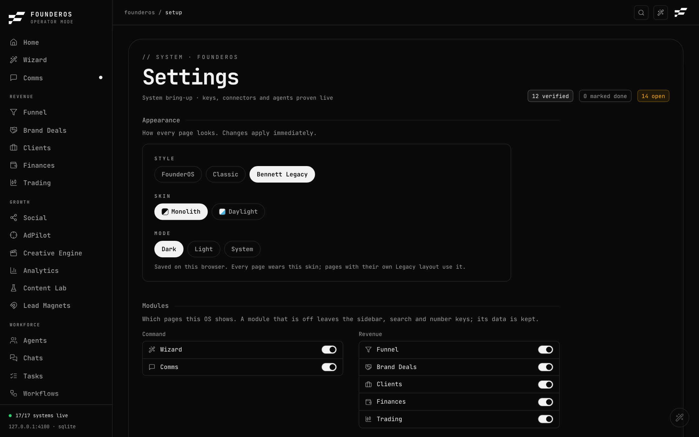

# Settings

Settings is at `/setup`, in the System group of the sidebar. It controls how FounderOS looks, which pages show, which data it reads, who can open it, and it tracks the steps to get the whole system wired up.

To open it, click **Settings** in the sidebar, or press `Cmd+K` and type `settings`.

The page has these sections, top to bottom:

1. Appearance
2. Modules
3. Bring-up progress
4. Recording (Filming mode)
5. Security
6. The bring-up phases, with a place to paste API keys

## Appearance

Controls how every page looks. Changes apply immediately and are kept per browser, so another device can use a different look.

1. Open **Settings**, then find **Appearance**.
2. Under **Style**, pick one of the three looks:
   - the product style (named after the app),
   - **Classic**,
   - **Bennett Legacy**.
3. Pick a colour. In the product style you choose an accent: Ice, Lime, Ember or Mint. In Classic you pick one of the Classic themes.
4. Pick a mode: **Dark**, **Light** or **System**. System follows your computer's setting. In Classic, the mode comes from the theme you choose.

Switching style does not lose your colour choice in the other style.

## Modules

Choose which pages this installation shows.

1. Open **Settings**, then find **Modules**.
2. Pages are grouped as in the sidebar. Use the toggle next to a page to switch it off or on.

A page that is off disappears from the sidebar, search (`Cmd+K`) and the number-key shortcuts. Its data is kept, so switching it back on restores everything.

## Bring-up

Bring-up is a checklist for getting the whole system working. A progress bar shows "N of M steps done". Two kinds of completion are counted:

- **Verified**: FounderOS checked it live (a key works, a file exists, a connector answers). Shown as "auto-verified".
- **Marked done**: a step only you can confirm, such as a setting in another app. Tick it yourself with **Mark done**. You can undo it.

The steps are in five phases:

| Phase | What it covers |
|---|---|
| 1. Foundation | The host serving, the operator password, the brain store, the verified send path, the approval bot |
| 2. Keys and connectors | Primary inbox, Attio, the AI gateway, Beehiiv, GoHighLevel, payments, Slack, Notion, ManyChat |
| 3. Hands-on steps | Things you do outside FounderOS, such as installing the engine CLI or granting WhatsApp Full Disk Access |
| 4. Builds owed | Agent features still to be built or enabled |
| 5. Make it yours | Forking the repository, merging knowledge bases and similar |

Some of these steps belong to the operator's own setup. In a fresh install, an open step simply means that part is not wired yet.

Click **open** on a step to go to the page that fixes it.

### Adding an API key from a step

A step that needs a key shows a text field while it is open.

1. Paste the value into the field on that step.
2. Save it. The key is written to `.env.local` and takes effect immediately.
3. The step turns **verified** once the connector answers.

Saved keys are shown masked (only the last four characters). FounderOS never shows a full secret back to you. You can also set keys on the Connections page: see [Integrations](integrations.md).

## Recording (Filming mode)

This card decides which dataset FounderOS reads. "Filming" is the app's name for the demo company.

- **Filming on**: reads `demo-data/`. Nothing on screen is real and nothing you write reaches your live data.
- **Filming off**: reads `data/`, your real data.

To switch:

1. Open **Settings**, find **Recording** (or **Filming mode**).
2. Click **Switch to real data** (or **Switch to sample data**).

The card also shows the folder currently in use. Switching never seeds, copies or deletes anything. It takes effect without a restart.

If the card says **Pinned by host**, the mode is fixed by `GLADOS_DATA_DIR` or `DEMO_MODE` in the environment, and the switch is disabled. Remove that setting and restart to change it.

Turn Filming on before recording a video or taking screenshots. A fresh install starts in Filming mode unless `GLADOS_DEFAULT_MODE=real` is set.

## Security

Sets who can open FounderOS.

- **No password**: FounderOS answers only on the computer it runs on (`127.0.0.1`). Any other address gets a 503 page that tells you to set a password. No login screen appears.
- **Password set**: every page and every API route asks for it. You sign in at `/login`.

### Set a password

1. Open **Settings**, find **Security**.
2. Click **Set password**.
3. Enter a new password of at least 8 characters, and repeat it.
4. Submit. You are signed in on this device.

The password hash and a session secret are stored in `.env.local` as `GLADOS_PASSWORD_HASH` and `GLADOS_SESSION_SECRET`. You never type these yourself. Setting a password does not need a restart.

### Reach FounderOS from another device

Setting a password alone does not open it to the network. You also choose the address it listens on.

1. Set a password as above.
2. Set `GLADOS_HOST` in `.env.local` to the address to listen on, such as your Tailscale address or `0.0.0.0`.
3. Restart FounderOS. Changing the address needs a restart.

Without `GLADOS_HOST`, FounderOS keeps listening on `127.0.0.1` even with a password. See [Troubleshooting](../troubleshooting.md#a-503-page-from-another-device).

### Change the password

1. Click **Change password**.
2. Enter your current password, then the new one twice.

### Sign out every other device

Click **Sign out others** and enter your current password. This replaces the session secret, so other devices must sign in again. This device stays signed in.

### Remove the password

Click **Remove password** and enter your current password. This signs the device out and puts FounderOS back to answering on this computer only, until you set a new password.

Every action except setting the first password asks for your current password again, so a tab left open is not enough to change it.

Sessions last 30 days. Too many wrong attempts in a short time are refused with "too many attempts, wait a minute".

### Forgot the password

See [Troubleshooting](../troubleshooting.md#i-forgot-my-password).

## API keys

Keys can be set in two places:

- on a step in the Bring-up checklist (above);
- in the **API keys** panel at the bottom of the Connections page ([Integrations](integrations.md)).

Both write to `.env.local`. All variables are listed in the [configuration reference](../reference/configuration.md).
