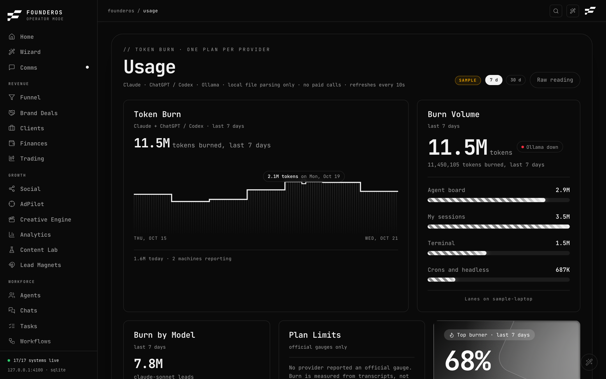
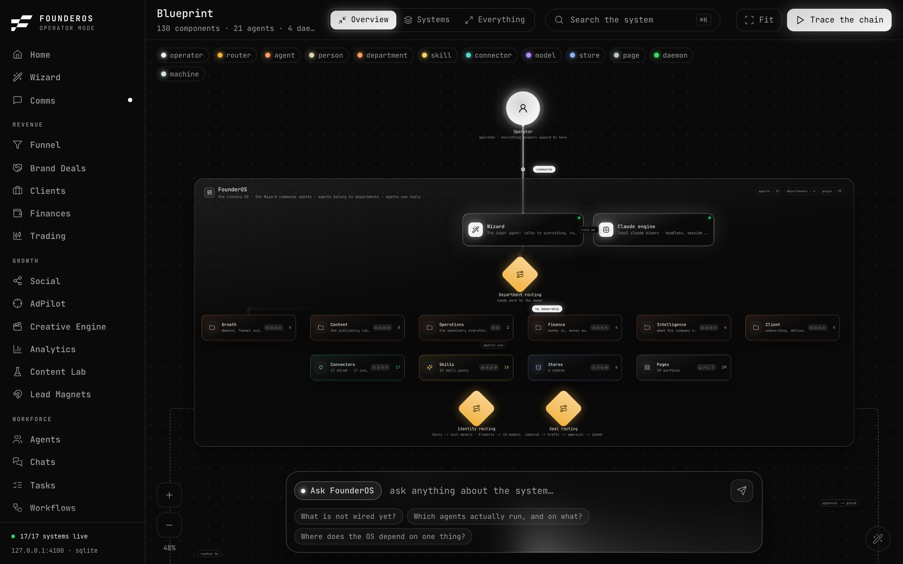
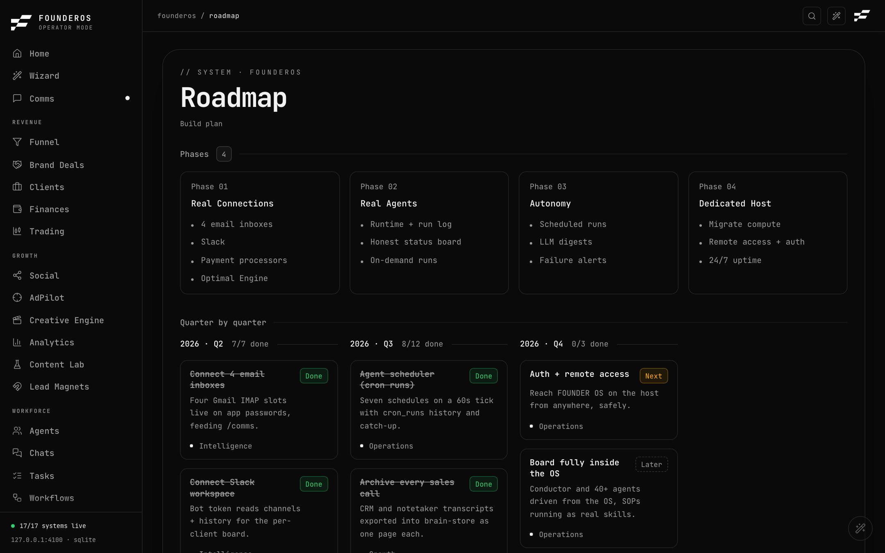

# Usage, Blueprint, Roadmap, Wizard and Login

Five smaller pages in one place.

## Usage

Path: `/usage` (System group).

Usage shows how many AI tokens you burn, by plan, model, lane and machine, against the provider's own limit gauges. It reads the transcript folders that Claude and Codex keep on your computer, so it needs no key.

**Demo mode:** Usage is off on a demo (Filming) install. It reads nothing from your home folder and says it is not available. Switch to real data to use it. See [Settings](settings.md#recording-filming-mode).

How the number is counted: burn = input + output + cache writes. Cache reads are not counted.

### Choose a time range

Use the range selector on the page to view 7 or 30 days. The page refreshes by itself every 10 seconds while you are looking at it.

### Where the data comes from

- **This computer:** transcripts in `~/.claude/projects` and `~/.codex/sessions`. Change the folders with `CLAUDE_PROJECTS_DIR` and `CODEX_SESSIONS_DIR`.
- **Other computers:** they can send their readings to `POST /api/usage/push` with `Authorization: Bearer <USAGE_PUSH_TOKEN>`. Set `USAGE_PUSH_TOKEN` to any long random string you choose and share it with those machines. The page can copy the push address for you.
- **Machine name:** this computer's name in the board is its hostname, unless you set `GLADOS_USAGE_MACHINE`.
- **Ollama:** the page also checks for a local Ollama on your computer.

If there is no transcript folder and nothing was pushed, the page shows **Not configured** instead of zeros.

## Blueprint

Path: `/blueprint` (System group).

Blueprint is a live map of FounderOS itself: its machines, groups and parts (agents, daemons, connectors and more), drawn from the system's own registries on every visit. The line under the title counts components, agents, daemons and machines, and says when the map was compiled. The counts change when the system does.

Use it to see what exists and how it connects. It is read-only.

## Roadmap

Path: `/roadmap` (System group).

Roadmap is the build plan, in two parts:

- **Phases**: high-level phases with their items.
- **Quarters**: roadmap items grouped by quarter, each with a status badge and its department.

Status badges are **Done**, **Now**, **Next** and **Later**. Done items are dimmed. In the product style, adding `?show=open` to the address hides completed items.

On a fresh real install the roadmap is blank until you add items.

## Wizard

Path: `/wizard` (Command group).

The Wizard is the chat you use to run the system. Each project is a conversation. A panel beside it shows the crew: the real run history of your agents.

Agent replies need an AI key. Without `AI_GATEWAY_API_KEY`, chat reports that it is not configured. See [Integrations](integrations.md). More on agents: [Workforce](../features/workforce.md) and [Command](../features/command.md).

## Login

Path: `/login`.

This is the only page reachable without a session. What you see depends on whether a password exists:

- **No password set:** the page says no password is set on this install, so there is nothing to sign in to. It gives two buttons: open FounderOS, or go to Settings to set a password.
- **Password set:** you see a password box. Enter the operator password to sign in. If you were sent here from another page, you return to it afterwards.

To set, change or remove the password, see [Settings](settings.md#security). If you forgot it, see [Troubleshooting](../troubleshooting.md#i-forgot-my-password).
